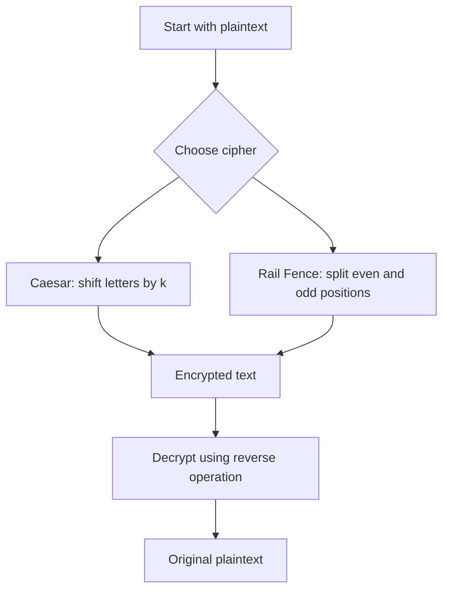
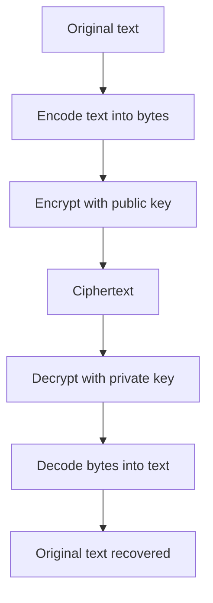
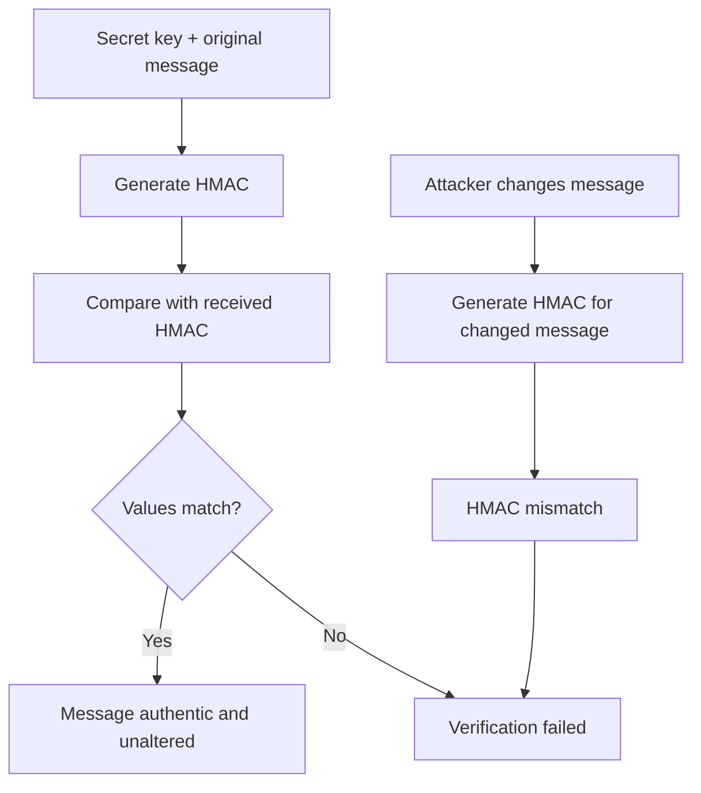
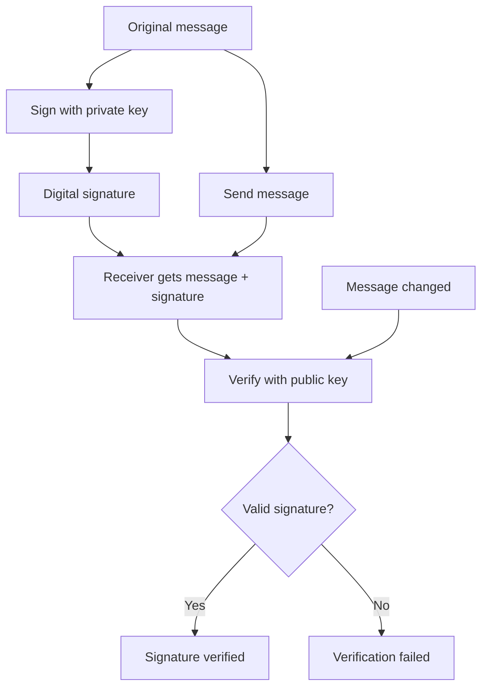
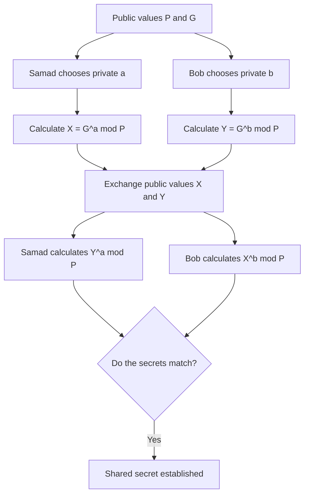

# Practical 1: Substitution and Transposition Ciphers

## Aim in one line

- **Caesar cipher:** changes letters by shifting them through the alphabet.
- **Rail Fence cipher (as implemented here):** rearranges characters by taking even-position characters first, then odd-position characters.

## Full code

```python
print("Name: Samad Shaikh | Roll No: 56\n")

def caesar_encrypt(text, shift):
    result = ""
    for ch in text:
        if ch.isalpha():
            base = ord('A') if ch.isupper() else ord('a')
            result += chr((ord(ch) - base + shift) % 26 + base)
        else:
            result += ch
    return result

def caesar_decrypt(text, shift):
    return caesar_encrypt(text, -shift)

def rail_fence_encrypt(text):
    return text[::2] + text[1::2]

def rail_fence_decrypt(cipher):
    mid = (len(cipher) + 1) // 2
    even, odd = cipher[:mid], cipher[mid:]
    result = ""
    for i in range(len(even)):
        result += even[i]
        if i < len(odd):
            result += odd[i]
    return result

plaintext = "Samad Shaikh Roll No 56"
shift = 3

print("Plaintext:", plaintext)
c = caesar_encrypt(plaintext, shift)
print("Caesar Encrypted:", c)
print("Caesar Decrypted:", caesar_decrypt(c, shift))

r = rail_fence_encrypt(plaintext)
print("Rail Fence Encrypted:", r)
print("Rail Fence Decrypted:", rail_fence_decrypt(r))
```

## Important lines

| Code | Meaning |
|---|---|
| `result = ""` | Start with an empty string to build the answer. |
| `for ch in text:` | Read the text one character at a time. |
| `if ch.isalpha():` | Shift only letters; keep spaces and digits as they are. |
| `ch.isupper()` | Check whether the letter is uppercase. |
| `ord(ch)` | Convert a character into its numeric code. |
| `chr(number)` | Convert a numeric code back into a character. |
| `% 26` | Keep the shifted letter inside the 26-letter alphabet. |
| `caesar_encrypt(text, -shift)` | Decrypt by shifting backwards. |
| `text[::2]` | Take characters at positions 0, 2, 4, 6… |
| `text[1::2]` | Take characters at positions 1, 3, 5, 7… |
| `(len(cipher) + 1) // 2` | Find how many characters were placed in the first group. |
| `return` | Send the result back to the place that called the function. |

## Formula

Let `x` be the letter number, where A = 0, B = 1, …, Z = 25.

**Caesar encryption:**

\[
E(x) = (x + k) \bmod 26
\]

**Caesar decryption:**

\[
D(x) = (x - k) \bmod 26
\]

Here, `k` is the shift. In this code, `shift = 3`.

### Tiny example

With shift 3: `A → D`, `B → E`, `C → F`.  
For decryption, reverse it: `D → A`.

## Logic diagram



## Memory trick

**Caesar = change letters. Rail Fence = change positions.**

For Caesar, remember: **ord → shift → modulo 26 → chr**.  
For Rail Fence, remember: **even positions + odd positions; then interleave to decrypt**.

---

# Practical 2: RSA Encryption and Decryption

## Aim in one line

RSA uses a **public key to encrypt** and the matching **private key to decrypt**.

## Full code

```python
!pip install rsa -q
import rsa

print("Name: Samad Shaikh | Roll No: 56\n")

public_key, private_key = rsa.newkeys(512)
message = "Hello, I am Samad Shaikh, Roll 56"

encrypted = rsa.encrypt(message.encode('utf8'), public_key)
print("Original Message:", message)
print("Encrypted Message:", encrypted)

decrypted = rsa.decrypt(encrypted, private_key).decode('utf8')
print("Decrypted Message:", decrypted)
```

> `!pip install rsa -q` is a notebook installation command. Run it in a notebook such as Google Colab; in a normal terminal, use `python -m pip install rsa`.

## Important lines

| Code | Meaning |
|---|---|
| `import rsa` | Load the RSA library. |
| `rsa.newkeys(512)` | Generate a matching public and private key pair. |
| `public_key, private_key = ...` | Store both keys. |
| `message.encode('utf8')` | Convert text into bytes, which the encryption function expects. |
| `rsa.encrypt(..., public_key)` | Encrypt the message using the public key. |
| `rsa.decrypt(encrypted, private_key)` | Decrypt using the private key. |
| `.decode('utf8')` | Convert the decrypted bytes back into readable text. |

## Formula to remember

RSA's simplified textbook equations are:

\[
C = M^e \bmod n
\]

\[
M = C^d \bmod n
\]

- `M` = original message represented as a number
- `C` = ciphertext
- `e, n` = public-key values
- `d, n` = private-key values

The `rsa` library performs the key maths for this practical.

## Logic diagram



## Memory trick

**RSA = Public locks it; Private unlocks it.**

Order: **Generate keys → Encode → Encrypt → Decrypt → Decode**.

---

# Practical 3: Message Authentication Codes (HMAC)

## Aim in one line

HMAC checks whether a message is authentic and has not been changed. **It does not encrypt the message.**

## Full code

```python
import hmac
import hashlib

print("Name: Samad Shaikh | Roll No: 56\n")

secret_key = b"samad_shaikh_56_secret"
message = b"Transfer Rs.1000 - Samad Shaikh, Roll No 56"
mac = hmac.new(secret_key, message, hashlib.sha256).hexdigest()
print("Message:", message)
print("Generated HMAC:", mac)

received_mac = hmac.new(secret_key, message, hashlib.sha256).hexdigest()
if hmac.compare_digest(mac, received_mac):
    print("Verification: Message is authentic and unaltered.")
else:
    print("Verification: FAILED")

tampered = b"Transfer Rs.9000 - Samad Shaikh, Roll No 56"
tampered_mac = hmac.new(secret_key, tampered, hashlib.sha256).hexdigest()
if hmac.compare_digest(mac, tampered_mac):
    print("Tampered: accepted")
else:
    print("Tampered message detected: HMAC mismatch.")
```

## Important lines

| Code | Meaning |
|---|---|
| `import hmac` | Load the HMAC functions. |
| `import hashlib` | Load hash algorithms such as SHA-256. |
| `b"..."` | Store the message/key as bytes. |
| `secret_key` | The secret shared key used to create the HMAC. |
| `hmac.new(secret_key, message, hashlib.sha256)` | Create an HMAC using the secret key, message, and SHA-256. |
| `.hexdigest()` | Represent the HMAC as hexadecimal text. |
| `hmac.compare_digest(mac, received_mac)` | Safely compare the two HMAC values. |
| `tampered` | A changed version of the original message. |
| `if / else` | Choose the verification result based on whether the values match. |

**Exam note:** In this demonstration, `received_mac` is calculated from the original message again. In a real receiver, the receiver would calculate a fresh HMAC from the message it received and compare it with the MAC sent by the sender.

## Formula / concept

\[
\text{MAC} = \operatorname{HMAC}(\text{secret key},\text{message},\text{SHA-256})
\]

- Same key + same message → same HMAC.
- If the message changes → the HMAC should change.
- A valid HMAC supports integrity and authenticity checks; it does not hide the message.

## Logic diagram



## Memory trick

**HMAC = Make a tag → Compare tags → Match means pass.**

Remember the three keywords: **key, message, compare**.

---

# Practical 4: Digital Signatures

## Aim in one line

A digital signature helps verify who signed a message and whether the message was changed.

## Full code

```python
!pip install rsa -q
import rsa

print("Name: Samad Shaikh | Roll No: 56\n")

public_key, private_key = rsa.newkeys(512)
message = b"Signed by Samad Shaikh, Roll No 56"

signature = rsa.sign(message, private_key, 'SHA-1')
print("Message:", message)
print("Signature (first 30 bytes):", signature[:30], "...")

try:
    rsa.verify(message, signature, public_key)
    print("Signature Verified: Message is authentic.")
except rsa.VerificationError:
    print("Verification Failed!")

try:
    rsa.verify(b"Signed by Someone Else", signature, public_key)
    print("Tampered message verified (unexpected)")
except rsa.VerificationError:
    print("Tampered message: Verification Failed (as expected).")
```

## Important lines

| Code | Meaning |
|---|---|
| `rsa.newkeys(512)` | Generate a public/private key pair. |
| `message = b"..."` | Store the message as bytes. |
| `rsa.sign(message, private_key, 'SHA-1')` | Create a signature using the private key and SHA-1. |
| `signature[:30]` | Display only the first 30 bytes of the signature. |
| `try:` | Attempt an operation that may fail. |
| `rsa.verify(message, signature, public_key)` | Check the signature against the message using the public key. |
| `except rsa.VerificationError:` | Run this block if signature verification fails. |
| `b"Signed by Someone Else"` | A different message used to demonstrate tampering. |

## Formula / concept

Conceptually, the sender signs with the private key, and the receiver verifies with the public key:

\[
\text{Signature} = \operatorname{Sign}(\text{private key},\text{message})
\]

\[
\operatorname{Verify}(\text{public key},\text{message},\text{signature}) \rightarrow \text{valid or invalid}
\]

This practical uses the RSA library to perform the actual signing and verification.

## Logic diagram



## Memory trick

**Digital signature = Private key signs; Public key verifies.**

This is the opposite direction from the basic RSA encryption example:

- **RSA encryption:** public key encrypts → private key decrypts.
- **Digital signature:** private key signs → public key verifies.

---

# Practical 5: Diffie–Hellman Key Exchange

## Aim in one line

Diffie–Hellman lets two people calculate the same shared secret without directly sending that secret over the network.

## Full code

```python
import random

print("Name: Samad Shaikh | Roll No: 56\n")

P = 2147483647        # public prime
G = 5                 # public generator

samad_private = random.randint(2, P - 2)
bob_private = random.randint(2, P - 2)

samad_public = pow(G, samad_private, P)
bob_public = pow(G, bob_private, P)

print("Public Prime (P):", P)
print("Generator (G):", G)
print("Samad Shaikh's Public Key (x):", samad_public)
print("Bob's Public Key (y):", bob_public)

samad_secret = pow(bob_public, samad_private, P)
bob_secret = pow(samad_public, bob_private, P)

print("\nSamad Shaikh's Shared Secret:", samad_secret)
print("Bob's Shared Secret:", bob_secret)
print("Secrets match:", samad_secret == bob_secret)
```

## Important lines

| Code | Meaning |
|---|---|
| `import random` | Load the random-number function. |
| `P = 2147483647` | Public prime number used in the calculation. |
| `G = 5` | Public generator. |
| `random.randint(2, P - 2)` | Choose a private number in the given range. |
| `pow(G, samad_private, P)` | Calculate \(G^a \bmod P\) efficiently. |
| `samad_public` / `bob_public` | The public values they can exchange. |
| `pow(bob_public, samad_private, P)` | Calculate Samad's version of the shared secret. |
| `pow(samad_public, bob_private, P)` | Calculate Bob's version of the shared secret. |
| `samad_secret == bob_secret` | Check whether the two calculated secrets match. |

## Formula to remember

Let Samad's private number be \(a\), and Bob's private number be \(b\).

**Public values:**

\[
X = G^a \bmod P
\]

\[
Y = G^b \bmod P
\]

**Shared secret:**

\[
K_{\text{Samad}} = Y^a \bmod P
\]

\[
K_{\text{Bob}} = X^b \bmod P
\]

Both should produce the same value:

\[
K_{\text{Samad}} = K_{\text{Bob}}
\]

In Python, `pow(base, exponent, modulus)` computes the modular exponentiation.

## Logic diagram



## Memory trick

**Random → Public → Exchange → Shared → Compare.**

Remember: they exchange **public values**, not their private numbers or the final shared secret.

---

# Last-minute comparison table

| Practical | Main purpose | Most important line / idea | Memory trick |
|---|---|---|---|
| P1: Ciphers | Hide text by shifting/rearranging | `% 26`, `text[::2]`, `text[1::2]` | Change letters / change positions |
| P2: RSA | Encrypt and decrypt | `rsa.encrypt(..., public_key)` | Public locks, private unlocks |
| P3: HMAC | Check message integrity/authenticity | `hmac.new(...)`, `compare_digest(...)` | Generate tag, compare tags |
| P4: Digital signature | Sign and verify | `rsa.sign(...)`, `rsa.verify(...)` | Private signs, public verifies |
| P5: Diffie–Hellman | Establish a shared secret | `pow(base, exponent, P)` | Random, public, shared, compare |

# Formula sheet

1. **Caesar encryption:** \(\displaystyle E(x)=(x+k)\bmod 26\)
2. **Caesar decryption:** \(\displaystyle D(x)=(x-k)\bmod 26\)
3. **RSA encryption:** \(\displaystyle C=M^e\bmod n\)
4. **RSA decryption:** \(\displaystyle M=C^d\bmod n\)
5. **HMAC:** \(\displaystyle \operatorname{HMAC}(\text{key},\text{message},\text{hash})\)
6. **Diffie–Hellman public values:** \(\displaystyle X=G^a\bmod P,\quad Y=G^b\bmod P\)
7. **Diffie–Hellman shared secret:** \(\displaystyle K=Y^a\bmod P=X^b\bmod P\)

Digital signatures are best remembered as a **process** rather than one simple formula: **sign with private key; verify with public key**.

# Five quick viva questions

**1. What is the difference between substitution and transposition?**  
Substitution changes the symbols; transposition changes their positions.

**2. Why does Caesar cipher use `% 26`?**  
To wrap around the 26 letters of the alphabet.

**3. Does RSA use the same key for encryption and decryption?**  
No. This practical uses a public key to encrypt and a private key to decrypt.

**4. Does HMAC encrypt a message?**  
No. It checks integrity and authenticity; the message remains readable if it is not separately encrypted.

**5. What is the goal of Diffie–Hellman?**  
Two parties calculate the same shared secret without sending that secret directly.

# Important practical note

The supplied practical code uses **512-bit RSA keys** and **SHA-1** for the signature demonstration. These are outdated for real-world security, but they are preserved here because this is a revision guide for the given practical. Do not treat these settings as modern production recommendations.
